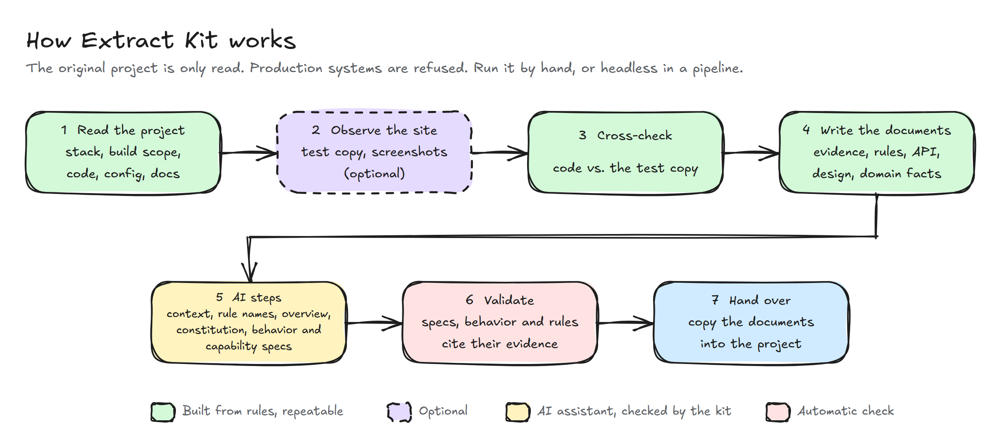

# 99x Extract Kit

Extract Kit studies an existing software project and writes down what it
does: its business rules, its pages and components, its data, and the
systems it talks to. The result is a set of standard documents a team can
use to plan a rebuild, a migration, or a handover, without having to
reverse-engineer the old system first.

Every requirement and rule in those documents points to the file and line
where it was found. Anything an AI assistant adds is marked as inferred and
must cite its evidence too.

## Why use it

- **Know the system before you change it.** In older projects much of the
  knowledge lives only in the code, or with people who have left. The kit
  turns it into readable documents.
- **Evidence, not opinion.** Each requirement and rule cites where it comes
  from. A final check rejects any requirement that has no proof.
- **Hidden business rules come to light.** Conditions buried in page
  templates and scripts are collected in one list. Rules that are repeated,
  or that differ between files, are flagged for review.
- **Ready for the next team.** The documents use formats current tools and
  teams already know: Spec Kit (constitution and specs), OpenAPI with a
  Swagger page, and DESIGN.md.
- **Safe to run.** The original project is only read, never changed.
  Production systems are refused. Documents enter the project only when
  someone decides to copy them in.
- **Repeatable where it counts.** Most documents are built from rules, not
  written by an AI model, so the same project gives the same result. The
  few steps that need judgment are handed to an AI assistant, and the kit
  checks what the assistant writes.

## How it works

1. **Read the project.** Scan the source code, configuration, page
   templates, and existing documentation.
2. **Observe the running site.** Visit a test copy with sample content to
   see which pages and components are really in use, and take desktop and
   mobile screenshots. Optional.
3. **Cross-check.** Compare what the code declares with what the site
   shows. Each component is marked as in use, unused, seen only
   sometimes, or not observed.
4. **Write the documents.** Turn the collected facts into the documents
   listed below.
5. **AI steps.** An AI assistant names the business rules and writes the
   business overview. See [AI steps](#ai-steps) below.
6. **Validate.** Check that every requirement and rule cites its evidence.
7. **Hand over.** Copy the main documents into the project, where the next
   team picks them up.

## AI steps

Some work needs judgment that rules cannot give, such as what a condition
in a template means for the business. The kit packages that work as AI
steps: it ships the instructions for each step, hands them to an AI
assistant (for example Claude Code), and checks the result. The kit does
not connect to an AI model itself, so you choose which assistant runs them.

<!-- markdownlint-disable MD013 -->
| AI step | What the assistant does | Required |
| --- | --- | --- |
| Name the business rules | Gives each extracted rule a plain business name and a one-sentence purpose | Yes |
| Write the business overview | Writes BUSINESS.md from the extracted facts: purpose, actors, capabilities, business flow, rules, glossary, integrations, open questions | Yes |
| Polish the specifications | Rewrites the requirement and journey text so it reads better, without changing the facts | No |
| Review the specifications | Checks the specs against the code and the business overview, writes a findings report, and changes nothing | No |
<!-- markdownlint-enable MD013 -->

The Spec Kit files (constitution and specs) are not one of these steps. The
kit writes them from rules, from the extracted facts, and never runs Spec Kit
or an AI model to do it. Spec Kit's own agent commands, such as
`/speckit.plan` and `/speckit.tasks`, run after hand-over, with the next
team's own assistant.

Every sentence an assistant adds that is not an extracted fact is marked as
inferred and must cite its evidence, or the validation step fails. Rule
names stay proposals until an analyst confirms them; the assistant never
confirms its own work.

## What you get

<!-- markdownlint-disable MD013 -->
| Document | What it answers |
| --- | --- |
| Constitution | The ground rules of the extract: evidence over assumption, what is in and out of scope |
| Specification, one per business area | What each part of the system does today, as numbered requirements with acceptance criteria and evidence |
| Business overview (BUSINESS.md) | Purpose and audience, actors, capabilities, the business flow, business rules, glossary, integrations, and open questions |
| Business rules catalogue | Every rule found in templates and scripts, where it lives, and which ones repeat or differ |
| User journeys | Scenarios for each page and component, written as Given / When / Then |
| Product summary (PRODUCT.md) | The capabilities of the system and whether each one is in use |
| Front-end patterns (DESIGN.md) | Every page, layout, and component, with its inputs and what it contains |
| Integrations API docs (OpenAPI, Swagger UI) | The services the system offers, the outside systems it calls, and third-party scripts, in a browsable page |
| Project map | Components, content types, routes, and business areas, and how they relate |
| Technical overview and reading guide | A walkthrough of the system and of how to read the extract |
| Visual baseline (optional) | Desktop and mobile screenshots of each sampled page |
| Upgrade compatibility report (optional, Enonic) | A factual list of what an Enonic XP 7 to XP 8 upgrade would touch |
| Unused code report | Code that appears unused. Nothing is deleted |
| Existing documentation | A copy of the project's own docs, collected in one place |
<!-- markdownlint-enable MD013 -->

## What it needs

- **The project's source code** (required): a local copy of its repository.
- **Existing documentation** (optional): READMEs and docs folders are
  picked up automatically.
- **A running test copy with sample content** (optional): a local or
  review environment of the site, with its CMS database and a saved login.
  Never production. Without it, the documents still come from the code;
  only "is this in use?" stays unanswered.

## What it does not do

- **It does not build anything.** It describes the system as it is today.
  It does not implement, port, or rewrite code.
- **It does not plan the work.** There is no migration plan or task
  breakdown. The specifications are ready for the team that does that next.
- **It does not change the project.** The source is read-only. Copying the
  documents in is a separate, explicit step.
- **It does not touch production.** Production addresses are refused.
- **It does not have the final word on business meaning.** Rule names
  from the AI steps are proposals until an analyst confirms them.
- **It does not delete code.** Unused code is reported, never removed.

## Supported projects

- **Enonic XP 7** sites: fully supported.
- **Page templates and front-end code** are scanned in every run: FreeMarker,
  Thymeleaf, Mustache, Handlebars, Pebble, React, Next.js, Angular, Vue, and
  jQuery.
- **PHP**: planned, not available yet.

## For operators

Install once with `./extractkit install` in this repo; it puts `extractkit`
on PATH and the two skills where your assistant finds them. Then open the
project you want to extract in your assistant and run `extractkit` from
there, not from this repo. Install, commands, and options are in the
[usage guide](docs/usage.md). In
the commands and detailed docs, the output folder is called the *sidecar*
and the local copy of the project the *checkout*.

Docs: [LLM instructions](docs/llm.md), [usage](docs/usage.md),
[flow](docs/flow.md), [CLI](docs/cli.md), [steps](docs/steps.md),
[profiles](docs/profiles.md), [output](docs/output.md).

Agents: read [docs/llm.md](docs/llm.md) first.
