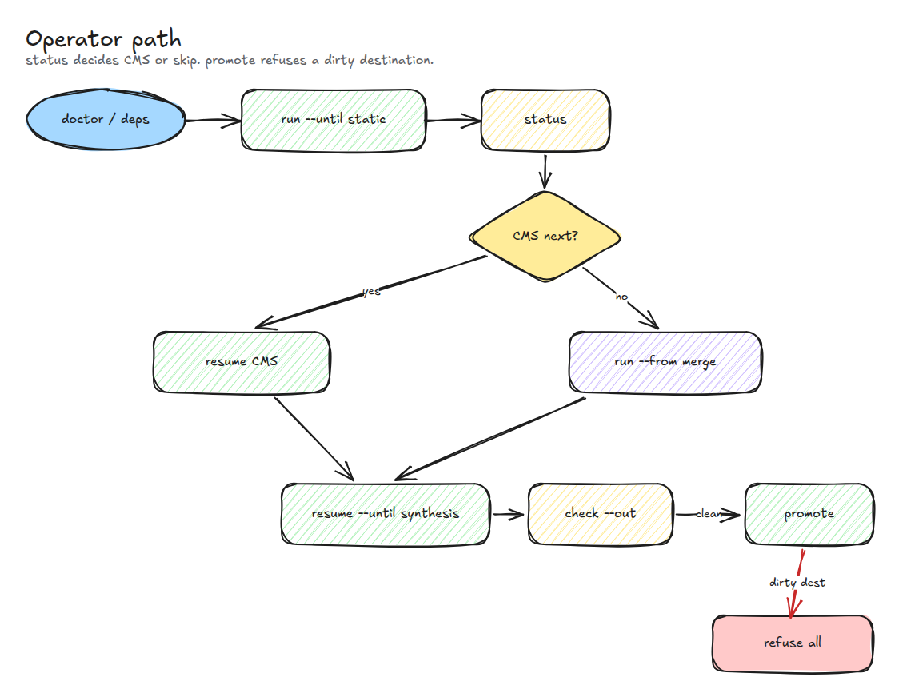
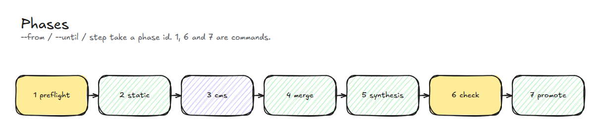
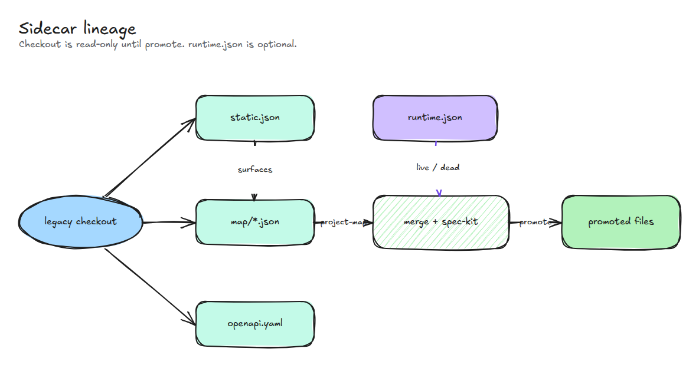

# Flow

How extractkit moves from a legacy checkout to a sidecar, then optionally
back into the checkout. Commands and artifacts are named exactly as the
CLI prints them.

## Operator path

`doctor` / `deps` print a `next` of `run --until static`. After that,
`status` (alias `next`) is the map: every phase is done, current, or
pending. The current phase's missing marker decides the command.

A full Enonic run without `--until` includes CMS and needs `--branch`
and `--storage-state`. The skip path is the offline route in the README.

`pipeline_state` in `extractkit_cli/progress.py`:

- `cms`: first incomplete slot is `inventory.runtime` and more slots
  remain. Next is `resume` with CMS flags, or `run --from merge`.
- `offline`: only CMS is missing. Next is `check`, or add CMS and
  rebuild merge and synthesis.
- `complete`: next is `check`.
- `other:<slot>`: next is `resume` from that slot.

`promote` writes on the first call. It refuses the whole copy when an
existing destination is modified, staged, untracked, or ignored, or when
the source is not a git work tree. `--force` overwrites. After a clean
promote, `next` is `git status` in the checkout.

## Phases

`profiles/core.yaml` groups the pipeline. `--from`, `--until`, and
`step` accept a phase id or number, or a slot or plugin id. Phases 1, 6,
and 7 are commands: passing them to `--from` / `--until` / `step` is
refused.

Slot contents and done-markers are in [steps](steps.md). Command flags
are in [CLI](cli.md#phases).

## Sidecar lineage

The checkout is read-only until `promote`. Default `--out` is
`<source>/.extract/<run-id>/`. Maps and OpenAPI stay in the sidecar.

`runtime.json` is optional and comes from a local or review XP, not from
scanning the checkout. Without it, `maps.merge` leaves page, layout,
part, and macro as `unverified-live`. With it, those kinds become
`live`, `dead`, or `conditional`. CMS also patches
`openapi.yaml` `x-production-endpoints`; those URLs are never fetched.

What each file is, and the promote map, is in [output](output.md).
