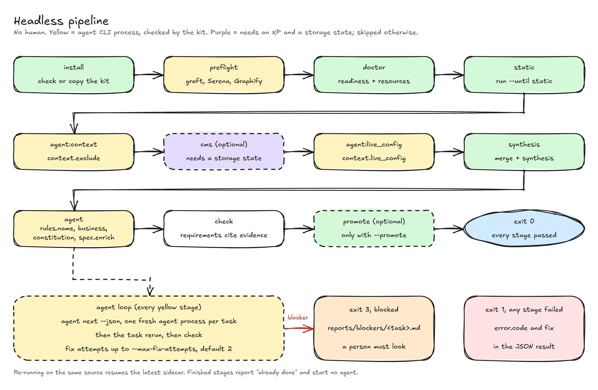

# Headless and pipelines

`extractkit headless` runs the whole extract with no human: it calls an agent
CLI for the preflight and for each agent task, and reports through one JSON
document and an exit code. It is the only command that starts an agent CLI;
every other command never calls a model. For the procedure an interactive
agent follows, see [LLM instructions](llm.md). Flags are in [CLI](cli.md).

## What a pipeline supplies

A pipeline supplies four things. Nothing else is read: no step reads a file
or a database beyond the source checkout and the storage state, so there is
no resource type for either.

<!-- markdownlint-disable MD013 -->
| Resource | What | How to supply it | Checked by |
| --- | --- | --- | --- |
| Legacy checkout | The folder to extract. Mounted or checked out; the run writes `extract/` there | `--source` / `EXTRACTKIT_SOURCE` | `doctor --source` |
| XP instance (optional) | A local or review XP with the app and a content dump. Production hosts are refused. Without it the run is offline and skips the CMS phase | `xp:` in the resources file, or the CMS flags | `xp host`, `guillotine` rows |
| Auth (needed for the XP) | A Playwright storage state for that XP | `auth.storage_state`, `--storage-state`, or `EXTRACTKIT_STORAGE_STATE_JSON` (the file contents, or the path a CI file variable gives); or a `cms_url` [attachment](#attachments), which headless logs in with | `storage state` row |
| Agent | An agent CLI that is logged in or has an API key | `agent:` in the resources file, `--agent`; the key in `EXTRACTKIT_AGENT_API_KEY` or as an `agent_api_key` [attachment](#attachments) | `agent cli`, `agent api key` rows |
<!-- markdownlint-enable MD013 -->

Headless needs a storage state to run the CMS phase. With none resolved (or a
login that fails) the `cms` stage is `skipped` and the run continues offline:
merge, synthesis, the agent tasks and check.

The default container image ([`docker/Dockerfile`](../docker/Dockerfile))
bundles the tools: Python 3.12 with `pyyaml` and `jsonschema`, git, and, installed
by [devkit](https://git.seeds.no/williams/99x-dev-kit) in headless mode with its
`extract` profile, Node with graft, Graphify, Serena, `playwright-cli` and 7-Zip;
then Playwright with Chromium, PHP with Composer, the `claude`,
`codex` and `cursor-agent` CLIs, and for the
[attachments](#attachments) the 1Password CLI (`op`) and
`/filter-by-name.sh`. The Compose example starts it, with an optional
`enonic/xp` service that is only useful when you also supply the
application and a content dump. [Building and reusing the
image](#building-and-reusing-the-image) covers slimmer variants.

## The resources file

`--resources FILE` (or `EXTRACTKIT_RESOURCES`) points at an operator-owned
YAML file. It is checked against `schemas/resources.schema.json`; agents never
write it. Values in it fill options that no flag and no env var set.

```yaml
xp:
  host: http://localhost:8080
  project: en
  branch: draft
  guillotine: http://localhost:8080/admin/site/preview/en/draft
  configenv: http://localhost:8080/admin/tool/example/config-env
  site_url: http://localhost:8080/admin/site/preview/en/draft
  cms_keys: [/site/start]
auth:
  storage_state: ./xp-storage-state.json   # relative to this file
agent:
  cli: claude                  # a name in the agents: block of extractkit.yaml
  permissions: allowlist       # or bypass
  model: claude-opus-4-5       # optional; passed through to the agent CLI
  effort: high                 # optional; refused if the agent has no effort_args
  allowed_tools: [Read, Write, Edit, Glob, Grep, "Bash(extractkit *)", mcp__serena]
  api_key_env: ANTHROPIC_API_KEY   # the agent's variable, never a value
  timeout_seconds: 1800
```

Precedence is CLI flag, then env var, then this file, then the default. The
`config` section of every `--json` result shows where each option came from
(`cli`, `env`, `file`, `default`).

`doctor --source DIR --resources FILE` adds a row per declared resource, each
with a 5 second timeout and no retries:

<!-- markdownlint-disable MD013 -->
| Row | `ok` when |
| --- | --- |
| `xp host` | The host is local or review, and an HTTP GET answers. A production host is refused (`production_host`) |
| `guillotine` | A `{ __typename }` POST, with the storage-state cookies, returns JSON without `errors` |
| `storage state` | The file exists, parses, and holds a cookie for the XP host |
| `agent cli` | The agent's binary is on PATH |
| `agent api key` | The variable named by `agent.api_key_env` is non-empty. Only presence is checked; the value is never read into output |
<!-- markdownlint-enable MD013 -->

With no `xp:` the three CMS rows are `skipped` (`offline run: CMS phase will
be skipped`) and do not count as failures. A failing probe is `MISSING` with
the error code `resource_unreachable` and a fix that names the key.

## Environment variables

Every long option `--foo-bar` has an env form `EXTRACTKIT_FOO_BAR`. A flag on
the command line beats the env var. Booleans take `1|true|yes` and
`0|false|no`, case-insensitive; anything else fails with `bad_env`. Repeatable
options (`--exclude`, `--cms-key`, `--round2`, `--allowed-tools`) take a
comma-separated list, and a flag of the same name on the command line replaces
the env list. An env var satisfies a required option: `EXTRACTKIT_SOURCE=.` is
enough for `run`.

These variables never work, and setting them fails with `env_forbidden`:
`EXTRACTKIT_ALLOW_PRODUCTION` and `EXTRACTKIT_FORCE` (for `--allow-production`,
`promote --force` and `install --force`). Headless never passes either flag.

`EXTRACTKIT_STORAGE_STATE_JSON` holds the storage-state file contents. In
GitLab make it a File-type variable: the JSON cannot be masked, and the
variable then holds the path of a file with the contents, which the kit reads.
It is written to a mode 0600 file in a private temp
folder, used as `--storage-state`, and deleted at exit. It conflicts with
`--storage-state` and `EXTRACTKIT_STORAGE_STATE`: set one (`bad_env`). Its
contents appear nowhere in stdout, the JSONL log or `MANIFEST.yaml`, and the
`config` section shows `<redacted>`.

Headless starts `extractkit` and the agent without any `EXTRACTKIT_*`
variable, and without the 1Password token and the archive passwords (see
[Attachments](#attachments)). It passes every setting as a flag, so a
variable meant for headless
(`EXTRACTKIT_UNTIL` takes a stage id there) cannot leak into a child command.

<!-- markdownlint-disable MD013 -->
| Variable | Option | Commands |
| --- | --- | --- |
| `EXTRACTKIT_SOURCE` | `--source` | most commands |
| `EXTRACTKIT_OUT` | `--out` | commands that take a sidecar |
| `EXTRACTKIT_PROFILE` | `--profile` | `context`, `deps`, `doctor`, `headless`, `resume`, `run`, `status`, `step` |
| `EXTRACTKIT_FROM`, `EXTRACTKIT_UNTIL` | `--from`, `--until` | `run`, `resume` (`--until`); `headless` takes a stage id |
| `EXTRACTKIT_EXCLUDE` | `--exclude` | `context`, `headless`, `resume`, `run`, `step` |
| `EXTRACTKIT_BRANCH`, `EXTRACTKIT_XP_HOST`, `EXTRACTKIT_GUILLOTINE`, `EXTRACTKIT_PROJECT` | CMS options | `headless`, `resume`, `run`, `step` (`EXTRACTKIT_XP_HOST` also `assets`) |
| `EXTRACTKIT_STORAGE_STATE` | `--storage-state` | `doctor`, `headless`, `resume`, `run`, `step` |
| `EXTRACTKIT_CMS_KEY`, `EXTRACTKIT_ROUND2`, `EXTRACTKIT_CONFIGENV`, `EXTRACTKIT_SITE_URL` | CMS options | `headless`, `resume`, `run`, `step` |
| `EXTRACTKIT_TASKS` | `--tasks` | `resume`, `run`, `step` |
| `EXTRACTKIT_RESOURCES` | `--resources` | `doctor`, `headless`, `resume`, `run`, `step` |
| `EXTRACTKIT_JSON`, `EXTRACTKIT_VERBOSE`, `EXTRACTKIT_QUIET` | `--json`, `-v`, `-q` | most commands |
| `EXTRACTKIT_PROGRESS` | `--progress` | `resume`, `run`, `step` |
| `EXTRACTKIT_AGENT`, `EXTRACTKIT_AGENT_PERMISSIONS`, `EXTRACTKIT_AGENT_MODEL`, `EXTRACTKIT_AGENT_EFFORT`, `EXTRACTKIT_ALLOWED_TOOLS`, `EXTRACTKIT_AGENT_ENV` | `--agent`, `--agent-permissions`, `--agent-model`, `--agent-effort`, `--allowed-tools`, `--agent-env` | `headless` (`EXTRACTKIT_AGENT` also `assets`) |
| `EXTRACTKIT_AGENT_API_KEY` | none (a secret has no flag): the agent credential, exported as the entry's `api_key_env` | `headless`. See [Agent credential](#agent-credential) |
| `EXTRACTKIT_DEVKIT_PROFILE` | `--devkit-profile` | `headless`. The image sets it to `extract` |
| `EXTRACTKIT_MAX_FIX_ATTEMPTS`, `EXTRACTKIT_TASK_TIMEOUT` | `--max-fix-attempts` (0 or more), `--task-timeout` (1 or more) | `headless` |
| `EXTRACTKIT_PROMOTE` | `--promote` | `headless` |
| `EXTRACTKIT_NO_ENRICH` | `--no-enrich` | `headless`. Accepted and ignored: `spec.enrich` is retired |
| `EXTRACTKIT_ASSETS_DIR`, `EXTRACTKIT_OP_VAULT`, `EXTRACTKIT_OP_ITEM`, `EXTRACTKIT_ASSETS_PASSWORD_ENV` | `--assets-dir`, `--op-vault`, `--op-item`, `--assets-password-env` | `assets`, `headless` |
| `EXTRACTKIT_STORAGE_STATE_OUT` | `--storage-state-out` | `assets` |
| `EXTRACTKIT_STORAGE_STATE_JSON` | storage-state contents | commands with `--storage-state` |
<!-- markdownlint-enable MD013 -->

## The stages

`headless` runs twelve stages in order and stops at the first failure. The
same ids are the values of `--until`, the `stage` field of the JSONL log and
the entries of `stages[]` in the result.



<!-- markdownlint-disable MD013 -->
| Stage | Does |
| --- | --- |
| `install` | `extractkit install --json` (a check when run from the installed copy) |
| `assets` | Reads the [attachments](#attachments) when a source is given (`skipped` otherwise). Never fails: what is missing or unreadable is printed, and the stages that needed it are `skipped` |
| `preflight` | Builds the graft index if `graft/` is missing. When Serena onboarding or the Graphify index is missing, starts one agent process with `headless/preflight.md`, then re-checks readiness (`readiness_missing`) |
| `doctor` | `doctor --source` with `--resources` |
| `static` | `run --until static --out <source>/extract/<run-id>` |
| `agent:context` | The agent loop, limited to `context.*` tasks |
| `cms` | `resume --until cms`, only when a storage state is resolved; otherwise `skipped` |
| `agent:live_config` | The same `context.*` loop, after the CMS slot |
| `synthesis` | `run --from merge --until synthesis` |
| `agent` | The full agent loop over the required tasks; `task_inputs_missing` when a task waits on a file nothing wrote |
| `check` | `check`; `check_failed` with the problems |
| `promote` | Only with `--promote`; never `--force` |
<!-- markdownlint-enable MD013 -->

The agent loop asks `agent next --json`. For each task it starts a fresh
agent process in the source folder with the rendered prompt behind
`headless/preamble.md` on stdin, runs the task's `rerun`, then `check`. When
`check` fails it starts a new process with the problems, up to
`--max-fix-attempts` (default 2) times, then writes a blocker. On the offline
route a `run` rerun whose range holds the CMS phase is split into the slice
before it and the slice after it, so it cannot fail at CMS preflight.

Headless writes the sidecar to `<source>/extract/<run-id>/`, a visible
folder with no `.gitignore`, so a pipeline publishes it as is. Interactive
commands keep `<source>/.extract/` and find the newest run under either
folder. Scans skip `<source>/extract/` once it holds a run.

The required tasks are `rules.name`, `business` (it re-runs
`product.impeccable`, which takes PRODUCT.md's users, jobs and capabilities
from `BUSINESS.md`) and `constitution` (it re-runs `spec.kit`, which composes
`spec-kit/constitution.md` from it). Then `domain.behavior`, `donotport` and
`spec.capabilities` write the domain files, `reports/do-not-port.md` and one
spec per capability. All are required: a blocker or fix attempts that ran out
stop the run.

A task whose `check` passes but whose output is not done (a missing file, a
done check that is not met) is told apart from a check failure. The log says
`check passed, but <id> is not done: <reason>`, the next attempt line says
`fixing: <id> not done`, the retry prompt is headed
`## <id> is not done after your last attempt`, and the blocker file says which
of the two cases failed.

The agent log and `reports/headless.jsonl` record the model each agent run
reports (the keys of `modelUsage` for `claude`). Headless warns when the log
holds `unrecognized_model`, or when the reported model differs from
`--agent-model` (else the variable named by the entry's `model_env`,
`ANTHROPIC_MODEL` for `claude`).

Re-running headless on the same source resumes the latest sidecar. A stage
whose outputs exist reports `ok (already done)` and starts no agent. The
`install`, `doctor` and `check` stages always run.

## Agent CLIs and permissions

The agent CLIs are data: the `agents:` block of `extractkit.yaml` gives each
one an `argv` template (the prompt is always sent on stdin), an optional
`wrapper:` (the command to start instead of `argv[0]` when `--devkit-profile NAME`
is set, for example `claude-{profile}`, the devkit profile wrapper that exports
`CLAUDE_CONFIG_DIR` and `AGENTS_HOME`), the flags for
`allowlist` and `bypass` permissions and a default tool allowlist.
`claude`, `codex` and `cursor` ship, with argv checked against `claude`
2.1.284, `codex-cli` 0.151.0 and `cursor-agent` 2026.10.01. Another CLI is a
new entry, no code change; `--agent` and `agent.cli` are checked against the
block when the command runs. The block is read by one function, so no flag or
env var can point headless at another binary.

What each assistant supports, checked on 2026-10-02 with one stdin run of each
CLI (run `extractkit --help`, write a file, call a Serena tool):

<!-- markdownlint-disable MD013 -->
| | Claude Code | Codex | Cursor |
| --- | --- | --- | --- |
| Interactive: reads `AGENTS.md` | yes (`CLAUDE.md` is a symlink to it) | yes | yes |
| Interactive: skills from | `~/.claude/skills` | `~/.agents/skills` | `~/.agents/skills`; depends on the Cursor version, not checked |
| `--agent` value | `claude` | `codex` | `cursor` (binary `cursor-agent`) |
| `allowlist` mode | per-tool: `allowed_tools` | `workspace-write` sandbox; `allowed_tools` is ignored | `--force` with `--sandbox enabled`; `allowed_tools` is ignored |
| `bypass` mode | `bypassPermissions` | `--dangerously-bypass-approvals-and-sandbox` | `--force --sandbox disabled` |
| `wrapper:` | `claude-{profile}` | `codex-{profile}` | `cursor-{profile}` |
| Serena MCP in headless | needs the server in the agent's own config | same | same |
| In the default container image | yes, pinned | yes, pinned | yes, unpinned (official installer); key in `CURSOR_API_KEY` |
<!-- markdownlint-enable MD013 -->

Only Claude Code limits an agent to named tools. Codex and Cursor are limited
to a sandbox, so the `--allowed-tools` override has no effect on them. Cursor
in print mode waits for an approval no one answers unless `--force` is set,
which is why its allowlist route is the sandbox.

Permissions default to a narrow allowlist: the agent may read, edit files and
run `extractkit`, and the preflight may run `graphify` and use the Serena MCP.
Override it with `agent.allowed_tools` or `--allowed-tools`. Setting
`agent.permissions: bypass` (or `EXTRACTKIT_AGENT_PERMISSIONS=bypass`) skips
the allowlist; it is the operator's call and never a kit default. Prefer to
run a bypass only inside the container. Whatever the mode, `claude` is denied
the flags that lift the kit's own guards (`denied_tools` in `extractkit.yaml`:
any `extractkit ... --force`, any `--allow-production`, and a nested
`extractkit headless`), because the agent reads legacy source that could carry
instructions. Codex and Cursor have no per-command deny list; their sandbox is
the limit.

The agent process does not get the job's environment. It gets a base list
(`PATH`, `HOME`, `USER`, locale, `TMPDIR`, proxies and certificate variables,
`XDG_*`, `NODE_*`, `SSL_*`, `PLAYWRIGHT_*`), the variables that start with the
`env_prefixes` of its `agents:` entry (`ANTHROPIC_` and `CLAUDE_` for `claude`,
`OPENAI_` and `CODEX_` for `codex`, `CURSOR_` for `cursor`), its credential
and whatever `--agent-env NAME` names (repeatable). `CI_JOB_TOKEN` and the
job's other variables stay out. Add what a provider needs, for example AWS
variables for Bedrock, with `--agent-env`. Its output goes to
`<sidecar>/reports/headless/<stage>-<task>-<attempt>.log`; a run that stops
before the sidecar exists (a failed preflight) keeps them as
`<source>/extract/headless-<stage>-<task>-<attempt>.log`, inside the `extract/`
artifact. Those logs are agent output and may echo prompts.

Preflight needs the Serena MCP and, for the Graphify skill fallback, the
graphify skill configured for the agent on the runner. Headless detects a
missing readiness item and fails with `readiness_missing`; it does not
install tools. The container image has them: the devkit `extract` profile
registers Serena as an MCP server for `claude`, `codex` and `cursor` alike.

### Agent credential

`EXTRACTKIT_AGENT_API_KEY` holds the credential for whichever agent is
selected, so a pipeline sets the same masked variable whatever `--agent` is.
Headless exports it under the entry's `api_key_env` (`CLAUDE_CODE_OAUTH_TOKEN`,
`OPENAI_API_KEY`, `CURSOR_API_KEY`) and removes the entry's `conflicting_env`,
for the agent process only. For `claude` the value is a `claude setup-token`
token, as in an attachment. An `agent_api_key` attachment wins over it; with
neither, the agent CLI's own variable from the job environment is used, so
`ANTHROPIC_API_KEY` still works for `claude`. Setting it for an entry with no
`api_key_env` fails at the start with `agent_option_unsupported`.

### Model and effort

`--agent-model` and `--agent-effort` (or `EXTRACTKIT_AGENT_MODEL`,
`EXTRACTKIT_AGENT_EFFORT`, or `agent.model` and `agent.effort` in the
resources file) choose them, in that order of precedence. Each `agents:` entry
may declare `default_model` and `default_effort`; none ships, so an unset value
means the agent CLI's own default and no flag is added. The kit does not check
the value: the CLI rejects a bad one (`agent_failed`).

The entry's `model_args` and `effort_args` say how the value reaches the CLI
(`{model}` and `{effort}` are filled in) and are placed before the permission
args. `cursor` has no `effort_args`, so an effort set for it fails at the start
with `agent_option_unsupported`, as does a model for an entry without
`model_args`. The CLI's own model variable (`model_env`, `ANTHROPIC_MODEL` for
`claude`) still reaches it through `env_prefixes`,
but `--agent-model` wins because it comes later on the command line. The
resolved values are in the `agent ... started` line, every agent line of
`reports/headless.jsonl` and the run summary (`default` when unset). On an
agent line the reported model replaces the requested one when the run reports it.

## Blockers and exit 3

There is no operator in a headless run. `headless/preamble.md` tells the
agent that wherever a task prompt says to stop and ask, it writes
`<sidecar>/reports/blockers/<task id>.md` with a `Reason:` and an `Evidence:`
line, and stops. When that file exists after a task, headless stops with exit
3 and `error.code: "task_blocked"`. Exhausting the fix attempts writes a
blocker too. Before a task starts, headless deletes that task's old blocker,
so a re-run after a human fixed the input gets a fresh attempt.

The analyst gates are unchanged: no agent ticks `[x]` in `rules/review.md` or
sets `out-of-scope: yes`, and an agent keeps a folder when unsure.

## Output and exit codes

### Progress on stderr

stdout stays clean for `--json`; progress goes to stderr, one line per event
with a time stamp, so a CI log shows the run moving:

```text
10:02:11 [5/12] static ...
10:02:11   step 1/6 map.code ...
10:02:14   step 1/6 map.code done in 3s, 4 action(s) recorded
10:02:40 [5/12] static ok in 29s: ok
10:02:40 [6/12] agent:context ...
10:02:41   agent claude started on context.decide (attempt 1, timeout 30m00s) ...
10:03:11   agent still working on context.decide: 30s elapsed, log 2048 B ...
```

Every stage prints its start and its result. The `run`, `resume` and `step`
children print one line per pipeline step (headless passes them `--progress`;
you can pass it too). An agent task prints when it starts, a heartbeat every
30 seconds with the log size and its last line, then the re-run, the `check`
result and each fix attempt. At the end headless prints a summary with the
duration of every stage, the total time, and the tokens and money the agent
runs reported. Each `agents:` entry in `extractkit.yaml` says how to read its
own log with a `usage:` block: `tokens` (JSON paths, summed), `cost_usd` (one
JSON path) or `tokens_regex` (one number group, for plain text). `claude`
runs with `--output-format json` and reads both; Codex reports tokens only;
Cursor's `json` and `stream-json` results carry no usage fields
([output format](https://cursor.com/docs/cli/reference/output-format)), so it
has no `usage:` block. An agent that reports nothing prints `the agent reported
no token or cost data`. The totals are in the envelope as `summary`
(`duration_s`, `agent_runs`, `usage.tokens`, `usage.cost_usd`), and each agent
line of `headless.jsonl` carries its own `tokens` and `cost_usd`. `-q`
silences all of it. The full record stays in `reports/headless.jsonl`.

`--json` (or `EXTRACTKIT_JSON=1`) prints one document on stdout and nothing
else, for every command. The same envelope carries the failure: `ok: false`,
and `error` with a stable `code`, the `message`, the `fix` text and, when the
fix is a command, `fix_command`. Usage errors from argparse stay on stderr
with exit 2, because they happen before `--json` is read. The envelope is
defined in `schemas/result.schema.json`; `headless` adds `stages[]`, and
`<sidecar>/reports/headless.jsonl` holds one line per stage (and one per agent
attempt) with `ts`, `stage`, `task`, `attempt`, `ok`, `exit`, `code`,
`message`, `duration_s` and `log`.

<!-- markdownlint-disable MD013 -->
| Exit | Meaning | CI job |
| --- | --- | --- |
| 0 | Every stage passed | pass |
| 1 | A stage failed, or a flag was refused | fail |
| 2 | Bad flag or command (argparse) | fail |
| 3 | Blocked: an agent wrote a blocker, a human is needed | fail, or `allow_failure` |
<!-- markdownlint-enable MD013 -->

## Building and reusing the image

Build once, tag, push, and reuse: a run never builds an image. The image
freezes the toolchain and a detached copy of the kit, including every profile.
Everything that varies per run is supplied at run time: the checkout (mounted
at `/work`), `--profile`, `--agent`, the resources file and the credentials.

The default build has every feature. Build arguments drop parts you do not
need; each is optional and keeps the default when omitted.

<!-- markdownlint-disable MD013 -->
| Build argument | Default | Effect |
| --- | --- | --- |
| `WITH_PLAYWRIGHT` | `1` | `0` leaves out Playwright and Chromium. The `enonic` baseline step needs them |
| `WITH_PHP` | `1` | `0` leaves out `php-cli` and `composer`, which the `php` profile uses |
| `WITH_1PASSWORD` | `1` | `0` leaves out the 1Password CLI (`op`), installed from its apt repository and not pinned |
| `AGENTS` | `claude codex cursor` | The agent CLIs to install, space separated. An unknown name fails the build |
| `RUN_AS` | `extract` | `root` starts the container as root, for runners that check the source out as root |
| `DEVKIT_PROFILE` | `extract` | The devkit profile installed in headless mode. The image sets `EXTRACTKIT_DEVKIT_PROFILE` to it |
| `*_VERSION` | pinned in the Dockerfile | Tool versions (`PLAYWRIGHT`, `CLAUDE_CODE`, `CODEX`, `UV`, ...). `cursor-agent` has no version argument. node, graft, Serena, Graphify and `playwright-cli` are pinned in devkit's `profiles/extract.json` |
<!-- markdownlint-enable MD013 -->

The image needs a checkout of devkit as the `devkit` build context. Build from
the kit root:

```bash
# the default, full image
docker build -f docker/Dockerfile --build-context devkit=../99x-dev-kit \
  -t extractkit-ci:latest .
# a slim image for the core profile, Claude only
docker build -f docker/Dockerfile --build-context devkit=../99x-dev-kit \
  -t extractkit-ci:core-claude \
  --build-arg WITH_PLAYWRIGHT=0 --build-arg WITH_PHP=0 \
  --build-arg AGENTS=claude .
```

A slim image still runs every profile: the tools a profile needs are optional
dependencies, so a missing one is `skipped` in `doctor` and its step reports
what it lacks. Use the full image when in doubt. The published tags are
overwritten by each build, so a pipeline that needs a fixed toolchain should
build and tag its own image. A rebuild can pick up a newer `cursor-agent`
than the one this page names, because its installer is unpinned.

### How a pipeline starts the image

The entrypoint ([`docker/entrypoint.sh`](../docker/entrypoint.sh)) follows the
`docker:cli` convention: flags run `extractkit headless --json`, another
`extractkit` command runs as given, and anything else (`sh`, `git`) is
executed unchanged with its exit code. A runner that starts the job container
with a shell and pipes the job script into it therefore gets its shell, so the
`image:` keyword needs no `entrypoint: [""]`. [`docker/smoke.sh`](../docker/smoke.sh)
checks those ways of starting the image, and the CI job runs it before any push.

The default image runs as uid 1000. When the source is not writable for that
user, headless stops before any stage with `source_not_writable`. Pass
`--user` to `docker run`, or use the `root` variant on a runner that clones as
root. The `claude` bypass permission mode refuses root; the default
`allowlist` mode works.

### Publishing to Docker Hub

[`.gitlab-ci.yml`](../.gitlab-ci.yml) builds two images of
[leanon/extractkit-ci](https://hub.docker.com/r/leanon/extractkit-ci) on every
change to the kit on the `docker` branch, and on no other branch: `latest`
(uid 1000) and `root` (the same image started as root). A `test` job runs the
unit tests and `ruff check` on every branch and merge request, and the build
only starts after it passes. Each tag is
overwritten by the next build; there are no per-commit tags. Each is
smoke-tested before it is pushed. The Docker Hub description is
`docker/README.md`, pushed by `docker-pushrm` from a manual job in a `docker`
branch pipeline; it never runs on its own. The pipeline needs
`CI_DOCKER_TOKEN`, a Docker Hub access token with `admin` scope (pushrm needs
it to write the description); `DOCKERHUB_USER` and `DOCKERHUB_REPO` are
variables at the top of the file.

## GitLab CI

```yaml
extract:
  image: leanon/extractkit-ci:latest   # or your own build of docker/Dockerfile
  variables:
    EXTRACTKIT_AGENT: claude
    EXTRACTKIT_AGENT_MODEL: opus
    EXTRACTKIT_RESOURCES: .extractkit/resources.yaml
    EXTRACTKIT_UNTIL: check
    # File-type CI/CD variable: the storage-state contents.
    # EXTRACTKIT_STORAGE_STATE_JSON
    # Masked CI/CD variable: EXTRACTKIT_AGENT_API_KEY, for any agent.
    # Or the credential and the XP login as attachments: see "Attachments".
  script:
    # The checkout is the legacy project, so cwd is the source.
    - extractkit headless --source "$CI_PROJECT_DIR" --json | tee extract-result.json
  artifacts:
    name: extract_${PROJECT_SHORT_NAME}_artifacts
    when: always
    paths:
      - extract/
      - extract-result.json
    expire_in: 2 weeks
  # Exit 3 means a task is blocked and a person must look; make it non-fatal
  # only when that is what the team wants.
  allow_failure:
    exit_codes: [3]
```

The job's artifact archive downloads as
`extract_<PROJECT_SHORT_NAME>_artifacts.zip` (GitLab adds the `.zip`;
`PROJECT_SHORT_NAME` comes from the base `.gitlab-ci`). `extract/` is the
artifact: the sidecar, `reports/headless.jsonl`, the agent logs and any
blocker file. In the container, flags go to
`extractkit headless --json`, so `docker run` and a Compose service take the
same flags; see [How a pipeline starts the image](#how-a-pipeline-starts-the-image).

## Attachments

A pipeline keeps its credentials as attachments on one 1Password item, or as
files in a folder. No file name is fixed: headless downloads every attachment,
then reads each file by its content, so `anything.bin` is as good as
`CLAUDE_CODE_OAUTH_TOKEN.yaml`. The same code runs standalone as
`extractkit assets`, which lists what it found and never prints a secret.

A file is a 7z archive, a zip archive, a YAML file or a JSON file. Archives may
be password-protected or not. Each document is a resource, `resource.type` plus
`resource.data`:

```yaml
resource:
  type: agent_api_key
  data:
    token: "<the token>"       # claude setup-token, OPENAI_API_KEY or CURSOR_API_KEY
    agent: claude              # required: the agent CLI that uses it
    validity: "2027-10-05"     # informational, never enforced
    priority: 10               # optional whole number, lower first, default 100
```

```yaml
resource:
  type: cms_url
  data:
    url: https://review.example.test   # any URL on the XP; XP 8 and 7 both tried
    login: admin
    password: "<the password>"
```

<!-- markdownlint-disable MD013 -->
| Type | Used for | When it is missing or fails |
| --- | --- | --- |
| `agent_api_key` | Needs `data.agent`, a name from the `agents:` block of `extractkit.yaml`; without it the resource is reported and not used. Only the selected agent's resources count. The token is exported as that entry's `api_key_env` (`CLAUDE_CODE_OAUTH_TOKEN`, `OPENAI_API_KEY`, `CURSOR_API_KEY`). The entry's `conflicting_env` is removed from the agent's environment, because for `claude` an API key outranks the OAuth token. With several usable ones see [Several credentials](#several-credentials) | The `agent:context`, `agent:live_config` and `agent` stages are `skipped`. A fresh checkout then stops at `doctor` with `readiness_missing`, because Serena onboarding and the Graphify index are made by the preflight agent; a prepared checkout runs on to `check`. This holds whenever an attachments source is given, even for an agent CLI that is logged in some other way; with no source, headless runs the agent as before |
| `cms_url` | A login to the XP, written to a mode 0600 Playwright storage state in a private temp folder. Only used when no `--storage-state` is supplied and `--xp-host` is set; with `--xp-host`, only the resource for that host. Production hosts are refused | The `cms` stage is `skipped`, as with no storage state |
<!-- markdownlint-enable MD013 -->

Other types are ignored with a note. These never stop the run, and each is
printed (also with `-q`) as `attachments: <file>: <what went wrong>`, never
with what the file said:

- the folder, the item or the `op` CLI is missing;
- an attachment cannot be downloaded or read;
- a file is not text, not an archive, not valid YAML or JSON, or not a resource;
- an archive needs a password that was not supplied, or none of them fits;
- `7z` is not installed;
- a login is refused.

`--assets-password-env VAR` (repeatable; a comma-separated
`EXTRACTKIT_ASSETS_PASSWORD_ENV`) names environment variables that hold archive
passwords. Each archive is tried with no password first, then with each one.
`7z` takes the password on its command line, so other processes in the job
container can see it while `7z` runs, before the agent starts.

Headless removes `OP_SERVICE_ACCOUNT_TOKEN*` and the password variables from
the environment of every process it starts, and gives the credential only to
the agent (and to `doctor`, which checks `agent.api_key_env`).

Download them with `--op-vault NAME --op-item NAME` (the `op` CLI reads
`OP_SERVICE_ACCOUNT_TOKEN`), read a folder or one file with `--assets-dir`, or
both.

### Several credentials

An item may hold several `agent_api_key` resources for the same agent, for
example more than one Claude seat. `data.priority` orders them (a whole number,
lower first, default 100; equal values keep the order the files were read in).

- With two or more, the `assets` stage probes them in order: one short agent
  call each, a one-word question. The first that answers is used. The probe
  costs a few tokens per credential and runs only when there are two or more.
- When the agent exits non-zero during a run, headless probes the credential in
  use. If it still answers, the failure was not about it and the run stops as
  before. If it does not (quota spent, token revoked), headless takes the next
  credential that answers and runs the same task again, without using up a fix
  attempt. The new agent is told that a previous run stopped midway and must
  complete the files, not start over. The switch is printed and logged as
  `credential_switched` in `reports/headless.jsonl`.
- When none answers, the run stops with `credentials_exhausted`. Run headless
  again later: finished tasks are not run again.
- Probing a credential that answers never changes it; a credential is only
  left behind in the order, never retried within the same run.

What is lost when a credential runs out is the one task in flight. Required
tasks each write one document from fixed inputs (`context.*`, `rules.name`,
`business`, `constitution`, `domain.behavior`, `donotport`, `spec.capabilities`),
so redoing one is a short run.

An agent that reports a spent quota in a JSON result and still exits 0 is
only caught by the probe at the start of a run, not during a task.

### Making an attachment

Write the YAML or JSON above. To protect it, make an archive on your machine.
Never put the credential or the passphrase in a command argument: `-p` without
a value makes `7z` ask for the passphrase, and `-mhe=on` also encrypts the file
names. The names inside and outside the archive do not matter.

```bash
umask 077
7z a -mhe=on -p agent.7z agent.yaml
```

Attach the file to the 1Password item, then delete the local files with
`shred -u`. The `claude` token comes from `claude setup-token`, needs a Claude
Pro, Max, Team or Enterprise plan, covers model requests only and lasts a year;
`codex` and `cursor` take API keys. The `claude` entry in `extractkit.yaml` has
no `--bare`, because bare mode ignores `CLAUDE_CODE_OAUTH_TOKEN`: keep it so.

### In a GitLab job

```yaml
extract:
  image: leanon/extractkit-ci:latest
  variables:
    EXTRACTKIT_AGENT: claude
    EXTRACTKIT_AGENT_MODEL: opus
    EXTRACTKIT_OP_VAULT: $OP_VAULT_NAME_FACTORY
    EXTRACTKIT_OP_ITEM: $OP_EXTRACT_NAME_FACTORY
    EXTRACTKIT_ASSETS_PASSWORD_ENV: PASSWORD   # set on each pipeline run
    EXTRACTKIT_XP_HOST: https://review.example.test
    EXTRACTKIT_BRANCH: draft
  script:
    - export OP_SERVICE_ACCOUNT_TOKEN=$OP_SERVICE_ACCOUNT_TOKEN_FACTORY
    - extractkit headless --source "$CI_PROJECT_DIR" --json | tee extract-result.json
```

