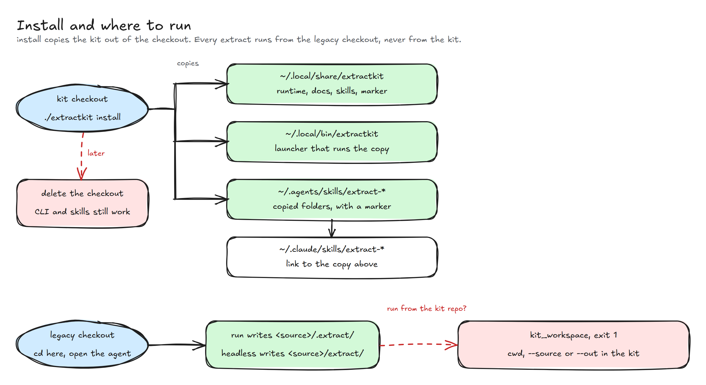

# Usage

How to run extractkit. For what the kit is and what it produces, start with
the [README](../README.md).

The output folder is called the **sidecar**: a run writes it to
`<source>/.extract/<run-id>/`, next to the legacy project (the **checkout**,
a local clone of its repository). `promote` copies as-is Spec Kit files into
the checkout. That is not an XP8 or React4XP port.

<!-- markdownlint-disable MD013 -->
| Profile | Detected from | What it does |
| --- | --- | --- |
| `enonic` | `src/main/resources/application.xml` or `site/site.xml` | XP7 inventory, OpenAPI harvest, optional live CMS |
| `php` | a root `composer.json` | Placeholder. `doctor` is green; `run` refuses with the todo list |
| `core` | never | Pipeline and phases only. No stack adapters |
<!-- markdownlint-enable MD013 -->

The kit ships no client profile. A run detects the stack and works out the
project's own facts (`exclude`, `live_config`) in the `context` phase. What
each phase needs, what is optional, and what it writes is in
[flow](flow.md#inputs-and-outputs).

Every command writes on the first call. There is no dry run.

Agents: read [llm.md](llm.md) first. It is the instruction set for driving
the kit and for the rule-naming step.

## Install

Python 3.12+ with PyYAML and jsonschema (already on the reference box), and
[devkit](https://git.seeds.no/williams/99x-dev-kit) on PATH: `deps` and
`doctor` fail with the install steps when `devkit` is missing. From the kit
repo, once:

```bash
./extractkit install
```

`install` copies the kit out of the checkout. Nothing it writes points back
into the checkout, so the checkout can be deleted afterwards:

- `~/.local/share/extractkit/`, a copy of the kit runtime, the agent docs
  (`docs/*.md`, without the diagrams) and the skills.
- `~/.local/bin/extractkit`, a launcher that runs that copy. `~/.local/bin`
  must be on PATH; the command fails and prints the `export` line when it is
  not.
- `~/.agents/skills/extract-legacy` and `extract-agentic`, copied folders for
  Codex, Cursor and other assistants.
- `~/.claude/skills/<skill>`, a link to the `~/.agents/skills/<skill>` folder,
  for Claude Code.

To update, run `./extractkit install` again from a fresh checkout. `install`
is idempotent. Each copied folder carries a `.extractkit-install.json`
marker, and `install` replaces only folders that carry it. It replaces a
symlink that points into a kit checkout (the old install) and a symlink that
points elsewhere only with `--force`. It never touches a file or folder it did
not create. Run from the installed copy, `install` copies nothing and only
checks. Preflight (`deps` and `doctor --source`) does the same, so the first
command of a run installs the kit even when nobody ran `install`.



## Where to run

Install the kit once, then run every command from the checkout you are
extracting, in an agent session opened there:

```bash
cd /path/to/legacy
extractkit doctor --source .
```

Do not drive an extract from the kit repo. Serena, Graphify and graft act on
the folder the agent session was opened in. A session opened in the kit
onboards and indexes the kit, so `doctor --source` keeps failing, and the
agent tasks would read the kit instead of the legacy code. The CLI refuses
to run an extract from the kit repo: it exits 1 with `kit_workspace` when the
working folder, `--source` or `--out` is inside it. It finds its own files
from its install path, and `--source` takes any legacy checkout.

## Headless and pipelines

`extractkit headless --source .` runs the whole extract with no human, for a
CI job: it calls an agent CLI for the Serena and Graphify preflight and for
each agent task. Every command also takes `--json` and reads `EXTRACTKIT_*`
variables. The agent token comes from `EXTRACTKIT_AGENT_API_KEY`, whatever
the agent, or with an XP login as [attachments](headless.md#attachments) that
`extractkit assets` can list without printing a secret. See
[Headless](headless.md). The published image is
[`leanon/extractkit-ci`](https://hub.docker.com/r/leanon/extractkit-ci), built
from `docker/Dockerfile`.


## Commands

Run from the legacy checkout (see [Where to run](#where-to-run)):

```bash
extractkit profile list
extractkit profile show enonic
extractkit profile show php
extractkit doctor --profile php          # empty PHP is allowed
extractkit doctor --source .             # + install, readiness, detected stack
extractkit deps --profile enonic         # + install; runs each probe
extractkit context --source .            # stack, build scope (run does it too)
extractkit run --source . --until static
extractkit status --source .
extractkit resume --source .
extractkit agent next --out .extract/<run-id>
extractkit check --out .extract/<run-id>
extractkit promote --source .
extractkit assets --assets-dir ./attachments   # types only, never the secret
```

## Next

Each run prints the phases it touched and ends with a `next` block: the
command to paste next. `status` (alias `next`) shows every phase as done,
current, or pending.

After synthesis, `next` points at `extractkit agent next` while a required
agent task is pending. Agent tasks are prompts stored in `agent-tasks/`:
they decide the context (`context.exclude`, `context.live_config`), name the
view-layer rules and write `BUSINESS.md`. The two context tasks come earlier,
right after the static phase and the CMS slot. The kit never calls a model
(`extractkit headless` is the exception: it starts an agent CLI for a pipeline
run); the `extract-agentic` skill runs them.

The path is in [flow](flow.md). Flags, `-v` / `-q`, and the promote
guard are in [CLI](cli.md).


## Source safety

The kit never edits the source `.gitignore` or `.git/`. A sidecar under
`<source>/.extract/` is self-ignored: `.extract/.gitignore` contains `*`. With
an `--out` outside the checkout a run writes nothing into the source.
`extractkit headless` writes `<source>/extract/` instead, with no `.gitignore`,
so a pipeline can publish it as an artifact; do not commit it.

## PHP

`extractkit run --profile php --source …` (or a checkout with a root
`composer.json`, which detection reads as PHP) exits non-zero with the
unfinished work list. It does not parse PHP.

## Static extract

Descriptors, maps, and OpenAPI only. A full Enonic run also surveys live
CMS and needs `--branch` and `--storage-state`.

```bash
extractkit run --source . --until static
```

The stack comes from the checkout. `--profile enonic` is only needed when
`run` says it found no stack marker. The first thing a run does is the
`context` phase: it records the stack and the folders no default-branch build
names in `.extract/<run-id>/context/`. When some folders are left undecided,
the `next` block offers `extractkit agent show context.exclude`. That task
picks the folders that are not part of the product, and the re-run it names
makes the scans skip them. An operator who already knows can pass
`--exclude <folder>` on the first run, or keep a standing decision in
`<checkout>/.extractkit/profile.yaml` (keys `exclude` and `live_config`; the
kit reads it and never writes it).

Then merge, docs, and Spec Kit without CMS:

```bash
extractkit run --source . \
  --out .extract/<run-id> \
  --from merge --until synthesis
```

`extractkit check` validates the sidecar. What it fails on is in
[CLI](cli.md#check).

## Runtime CMS

`enonic.cms` surveys a local or review XP only. Production hosts are
refused.

Required: `--branch draft|master`, `--storage-state`, and a Guillotine URL
(`--guillotine`). Pin keys with `--cms-key`. Do not walk the tree.

```bash
extractkit step enonic.cms --source . \
  --out .extract/<run-id> \
  --branch draft \
  --storage-state ~/.agents/.auth/xp7-localhost.json \
  --guillotine http://localhost:8080/admin/site/preview/en/draft \
  --cms-key /en
```

Survey rules and redaction are in
[steps](steps.md#inventoryruntime-enoniccms). The step also lists the Site
Config and Config Env keys that hold URLs or host maps in
`inventory/live-config-candidates.json`. The agent task
`extractkit agent show context.live_config` reads it, writes the project's
`live_config` rules into the overlay, and its re-run (`step inventory.runtime`
with the same CMS flags) rebuilds `runtime.json` endpoints. After CMS,
`maps.merge` updates page, layout, part, and macro status. The four values are in
[output](output.md#surface-status).

## Baseline and XP8 report

Two optional slots add what a port needs beyond the descriptors. Neither
fails a run. A skip prints the command to run.

```bash
# desktop 1440 and mobile 390 screenshots, rendered HTML, network list
extractkit step inventory.baseline --source . \
  --out .extract/<run-id> --branch draft \
  --storage-state ~/.agents/.auth/xp7-localhost.json

# factual XP7 to XP8 list, outside spec-kit/
extractkit step report.compat --source . \
  --out .extract/<run-id>
```

`inventory.baseline` needs `playwright-cli` and the runtime pages. It
refuses production hosts. `--site-url` replaces the preview base URL.
`reports/xp8-compat.md` is never promoted.

## View layer

Every profile also inventories the view layer. `inventory.templates` detects
FreeMarker, Thymeleaf, Mustache, Handlebars, Pebble, React, Next.js,
Angular, Vue and jQuery, and `maps.normalize` maps each template file into a
spec-ready `component` or `partial` surface (inputs, children, slots,
outputs, data source) without converting any code. `rules.view` then
harvests the business rules hidden in templates and view scripts, scores
them, flags rules that are repeated or that diverge between files, and
writes `rules/`. The kit extracts; the agent names the rules; an analyst
confirms them. Details: [steps](steps.md#inventorytemplates-coretemplates),
[rule naming](llm.md#7-agent).

## What the spec holds

`spec.md` states behavior from extracted facts only: fields, config
inputs, regions, controller calls with `file:line`, and the composition
runtime saw. Each FR has `Acceptance:` bullets and an `Evidence:` line.
`check` fails an FR without that line. These are the evidence specs in
`spec-kit/evidence/`. The specs an operator plans from are the capability specs
the `spec.capabilities` task writes (`extractkit agent show spec.capabilities`,
run by the [extract-agentic skill](../skills/extract-agentic/SKILL.md)).

## Promote

Explicit. Copies as-is Spec Kit constitution, PRODUCT, DESIGN, `BUSINESS.md`
when present, and per-context `spec.md` into the checkout. It does not copy
the sidecar into git.

It refuses, writing nothing, when git cannot restore an existing
destination. `--force` overwrites. Paths and the guard are in
[output](output.md#promote) and [CLI](cli.md#promote-guard).

## Tests

```bash
python3 -m unittest discover -s tests
```

Fixtures: `tests/fixtures/enonic-mini/` and `tests/fixtures/templates-mini/`.
No GitLab CI in this kit.
